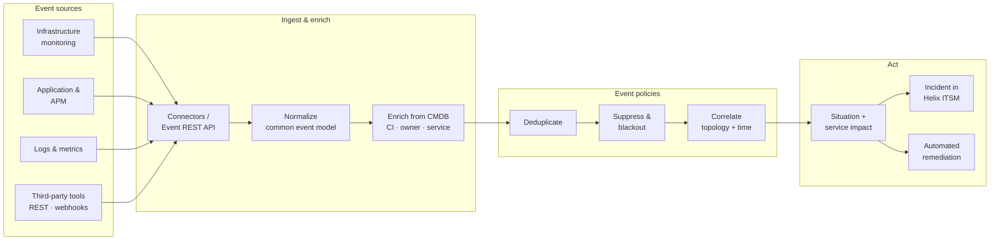
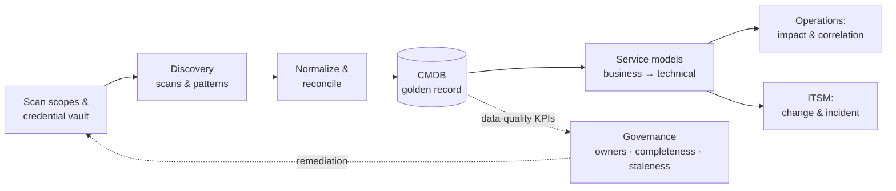
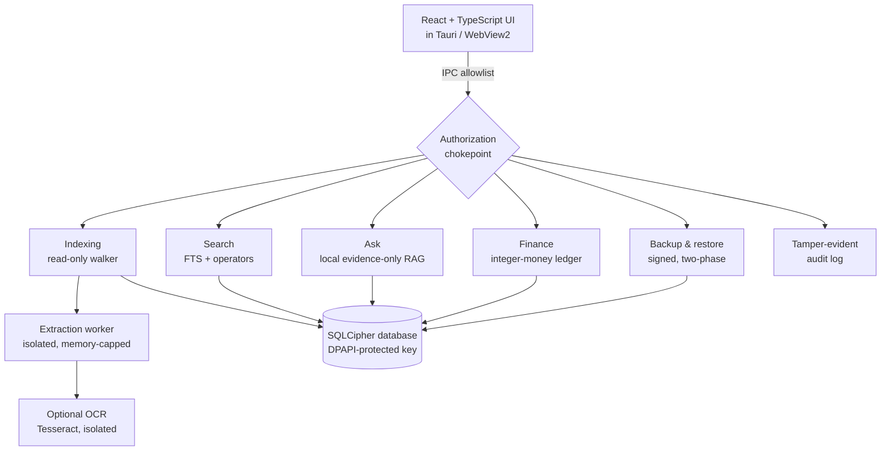

<!--
  Profile README for github.com/mshobin
  Repository: mshobin/mshobin (public, README.md at the root)
  Rule for this file: every number and claim must be something Shobin can defend in an interview.
-->

  

  
  
  
  

---

### I make enterprise IT operations quieter, clearer and more predictable.

I'm a **Team Leader for BMC Helix ITOM & AIOps** at Diyar United Company in Kuwait, with **20+ years** of enterprise
IT delivery behind me — from field engineering and SCCM/SCOM on an oil & gas estate, through **14 years as a Senior
Solutions Architect**, to leading a team that designs and runs **BMC Helix Operations Management, event correlation,
Discovery, CMDB and AIOps** for organizations across the Middle East and Asia.

Outside client work I build software products end to end — architecture, code, security model, tests, installers and
documentation. That's where most of this GitHub lives.

<table>
<tr>
<td width="50%" valign="top">

#### 🎯 Recruiter quick view

| | |
|---|---|
| **Role** | Team Leader · Solutions Architect |
| **Focus** | BMC Helix ITOM · AIOps · Observability |
| **Experience** | 20+ years enterprise IT (since 2005) |
| **Delivery** | 35+ key projects · 6 countries |
| **Industries** | Oil & gas · Banking · Telecom · Healthcare · Government · Energy · Education |
| **Strengths** | Solution architecture · Presales & PoCs · Delivery leadership · C-level advisory |
| **Location** | Kuwait (GCC travel) |

</td>
<td width="50%" valign="top">

#### 🧩 Problems I solve

- **Alert storms** → policies that deduplicate, suppress and correlate events into actionable situations
- **"What is this server for?"** → Discovery and a reconciled CMDB that service models can trust
- **Monitoring silos** → integrations that bring tools into one operational view
- **Reactive operations** → predictive, service-centric AIOps
- **Manual toil** → Python / PowerShell / REST automation
- **Tech that doesn't land** → presales, workshops and PoCs that tie platforms to business outcomes

</td>
</tr>
</table>

---

## 📊 Impact at a glance

<table>
<tr>
<td align="center" width="16%"><h2>20+</h2>years in enterprise IT</td>
<td align="center" width="16%"><h2>35+</h2>key projects delivered</td>
<td align="center" width="16%"><h2>6</h2>countries: KW · QA · SA · AE · BH · MM</td>
<td align="center" width="16%"><h2>7</h2>industries served</td>
<td align="center" width="16%"><h2>14</h2>years as Senior Solutions Architect</td>
<td align="center" width="16%"><h2>2</h2>products built end to end</td>
</tr>
</table>

---

## 🏗️ Architecture portfolio

Reference architectures for the problems I work on. They are **generic patterns** — no client names, data or
configurations — drawn to show how I think about the design.

<b>1 · Event management & correlation pipeline (BMC Helix Operations Management)</b>

 

**Design decisions:** enrich *before* correlating (correlation is only as good as the CI and service context on
each event) · suppress maintenance windows at policy level, not at the source · one incident per situation, not
per event · automation only for runbooks with a known, safe rollback.

→ [Full pattern, ADRs and go-live checklist](https://github.com/mshobin/itom-reference-architectures/blob/main/patterns/event-management-and-correlation.md)

<b>2 · Discovery → CMDB → service model</b>

 

**Design decisions:** reconciliation rules decide which source wins per attribute · service models are built from
the business service down, not the infrastructure up · CMDB quality is measured and owned, or it decays.

→ [Full pattern and data-quality KPIs](https://github.com/mshobin/itom-reference-architectures/blob/main/patterns/discovery-cmdb-service-model.md)

<b>3 · Product architecture — A.R.Q. (local-first, security-first desktop platform)</b>

 

---

## 🚀 Featured work

<table>
<tr>
<td width="50%" valign="top">

### 🗂️ A.R.Q. — Access. Retrieve. Quantify.
A private, **local-first document and household finance intelligence platform** for Windows. Search and question
your own files, keep an exact ledger and share selected documents with family — with no cloud, no accounts and no
telemetry.

**Engineering:** 22-crate Rust workspace · Tauri + React/TypeScript · SQLCipher encryption at rest ·
isolated extraction workers · 13 ADRs · threat model · 20-gate production-readiness checklist · CycloneDX SBOM ·
benchmarks to 100k files (search p95 under 100 ms at 10k).

`Rust` `Tauri` `TypeScript` `React` `SQLite/SQLCipher` `GitHub Actions` `Playwright`

**[Read the case study →](case-studies/arq.md)** · source private

</td>
<td width="50%" valign="top">

### ⛪ Kingdom Connect — Connect. Present. Worship.
A **service presentation platform for churches**: plan a service as Frames, then present to the room, to
Zoom / Teams / Meet through its own virtual camera, and to a stream — run from a PC, phone or iPad. Built for
volunteers, offline by default.

**Engineering:** Python backend + vanilla JS front end · virtual camera with background segmentation ·
PIN-protected phone remote · CI-built Windows installer with checksums · role-based guides for church teams ·
20+ versions shipped, v4.0 → v6.6.

`Python` `JavaScript` `MediaPipe` `Inno Setup` `GitHub Actions`

**[Read the case study →](case-studies/kingdom-connect.md)** · source private

</td>
</tr>
</table>

### 🧭 Open source · ITOM

<table>
<tr>
<td valign="top">

**[itom-reference-architectures](https://github.com/mshobin/itom-reference-architectures)** — reference designs for
event management & correlation and Discovery → CMDB → service model, each with architecture diagrams, ADRs, sizing
questions, anti-patterns, KPIs and a go-live checklist. Written for BMC Helix practitioners, vendor-neutral at heart.

`Event correlation` `CMDB` `Discovery` `Service modeling` `ADRs` `MIT`

</td>
</tr>
</table>

<!--
  More ITOM showcase repos — uncomment each card only once the public repo exists.

<table><tr>
<td width="50%" valign="top"><b><a href="https://github.com/mshobin/helix-ops-toolkit">helix-ops-toolkit</a></b> Python client and CLI for sending, querying and testing events against BMC Helix Operations Management.</td>
<td width="50%" valign="top"><b><a href="https://github.com/mshobin/event-correlation-lab">event-correlation-lab</a></b> A small, runnable simulator that shows dedup, suppression and topology correlation on synthetic events.</td>
</tr></table>
-->

---

## 🧰 Technology wall

**Operations & observability** 

**Practices** 

**Automation & engineering** 

**Infrastructure** 

---

## 🧭 Enterprise skills matrix

| Capability | Level | Evidence |
|---|---|---|
| BMC Helix ITOM & AIOps (Operations Management, event management, AIOps) | ●●●●● Expert | Team Leader for Helix ITOM & AIOps; regional delivery |
| Solution architecture & presales | ●●●●● Expert | 14 years Senior Solutions Architect; demos, PoCs, workshops |
| Delivery & team leadership | ●●●●○ Advanced | Leads ITOM team; supervised field engineers under SLAs |
| Discovery, CMDB & service modeling | ●●●●○ Advanced | Helix ITOM implementations |
| Microsoft systems management (SCCM, SCOM, AD/GPO) | ●●●●○ Advanced | Oil & gas estate: deployment, patching, monitoring |
| Automation (Python, PowerShell, REST) | ●●●●○ Advanced | Integrations; product build and release tooling |
| Product engineering (Rust, TypeScript, Python) | ●●●●○ Advanced | A.R.Q. and Kingdom Connect |
| Security engineering (threat models, encryption, supply chain) | ●●●○○ Proficient | A.R.Q. threat model, SBOM, cargo-deny, SQLCipher |

---

## 🗓️ Career timeline

| Years | Role | Highlights |
|---|---|---|
| **2025 – now** | **Team Leader, BMC Helix ITOM & AIOps** · Diyar United | Leads strategy, delivery and operations of Helix ITOM; predictive operations, event management, workflow automation across the Middle East |
| **2011 – 2025** | **Senior Solutions Architect** · Diyar United | BMC & Microsoft solutions for major organizations; presales, PoCs, C-level advisory, end-to-end delivery |
| **2009 – 2011** | **Microsoft IT Consultant** · oil & gas project | SCCM software deployment and remote control; SUS → SCCM patching; SCOM monitoring for clustered databases |
| **2007 – 2008** | **Business Desktops Deployment Lead** · oil & gas project | Enterprise Windows 7 rollout under policy; MED-V virtualization of drilling applications |
| **2005 – 2007** | **Technical Workshop Supervisor** · oil & gas project | Hyper-V automated builds; ITIL incident, problem and configuration management on BMC Helpdesk |
| **2004 – 2005** | **IT Trainer / Administrator** · St. Joseph's Convent, Cyprus | Systems administration and IT training |
| **2000 – 2004** | **B.S. Computer Science** · Cyprus College | |

---

## 🎓 Certifications

---

## 🔭 Current focus

- Predictive, service-centric operations on **BMC Helix AIOps**
- Event correlation patterns that cut noise without hiding real failures
- Publishing reusable ITOM patterns — [itom-reference-architectures](https://github.com/mshobin/itom-reference-architectures) — and tooling here on GitHub
- Taking **A.R.Q.** through its open production gates: code signing, clean-VM installer tests, external security review

---

## 📈 GitHub activity

  
  

  <picture>
    <source media="(prefers-color-scheme: dark)" srcset="https://raw.githubusercontent.com/mshobin/mshobin/output/github-snake-dark.svg">
    
  </picture>

---

## 🧭 How I work

> **Evidence over marketing.** If a feature isn't done or a result isn't verified, the documentation says so.
> **Reliability over features.** Operations software earns trust by never being the thing that fails.
> **Design from the service down.** Infrastructure exists to serve a business outcome; models and alerts should say which one.

---

  <b>Looking for BMC Helix ITOM / AIOps architecture, delivery leadership or a solutions architect for the GCC?</b> 
  <a href="mailto:mshobin@outlook.com">mshobin@outlook.com</a> · <a href="https://www.linkedin.com/in/mshobin/">linkedin.com/in/mshobin</a>

BMC, BMC Helix and other product names are trademarks of their respective owners. Architecture diagrams here are generic patterns and contain no client information.

