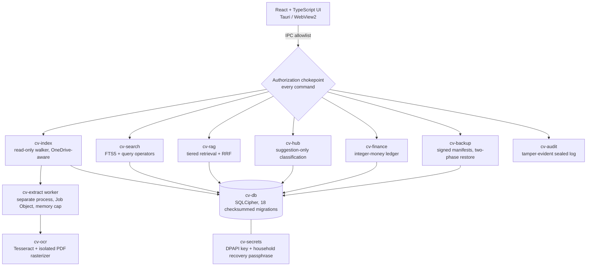

# Case study · A.R.Q. — Access. Retrieve. Quantify.

> A private, local-first document and household-finance intelligence platform for Windows, engineered with the
> discipline of enterprise software: ADRs, a threat model, supply-chain controls and a production-readiness gate
> that the product honestly does not yet pass.

| | |
|---|---|
| **Role** | Product owner, architect and sole engineer |
| **Status** | v0.3.0 (Oct 2026) · working, tested build · **not production-ready** by its own 20-gate checklist (12 ✅ · 7 ⚠ · 1 ❌) |
| **Stack** | Rust (22-crate workspace) · Tauri 2 · React + TypeScript · SQLite / SQLCipher · Windows DPAPI · Tesseract (optional) · GitHub Actions |
| **Source** | Private. Available for walkthrough on request. |

---

## 1 · Business challenge

Households keep their most sensitive records — IDs, insurance, contracts, medical reports, bank statements — scattered
across folders and OneDrive. Cloud tools that make those records searchable ask you to upload them. Personal finance
apps either sync to the cloud or use floating-point money that drifts.

**The goal:** make a family's documents and money searchable, answerable and organized **without any of it leaving
the PC** — and prove that claim, rather than just state it.

## 2 · Solution design

A Windows desktop application with a hard "offline by default" boundary:

- **Vault & search** over file names, properties and extracted text, with operators (`ext:pdf in:2024 larger:1mb`).
- **Ask**: questions answered with ranked excerpts from your own files and their sources — retrieval only, nothing
  generated, nothing sent anywhere.
- **Document Hub**: suggested categories and expiry dates that change nothing until a person confirms them.
- **Finance**: accounts, transfers, budgets, goals, recurring items, reconciliation and reports on an
  **integer-minor-unit ledger** (KWD with 3 decimals; floating-point arithmetic flagged by the linter).
- **People & permissions**: Admin / Member / Read-only / Child roles with per-profile grants enforced in the backend.
- **Backup & restore**: signed, checksummed backups; two-phase restore that preserves current data first.
- **Family Sharing** (off by default): the only feature that ever opens a connection, and only when started.

## 3 · Architecture

### Key architecture decisions (13 ADRs in the repo)

| Decision | Why |
|---|---|
| Rust + Tauri instead of Electron | Smaller attack surface and memory footprint; native Windows APIs (DPAPI, Job Objects) without a Node runtime |
| Parse untrusted files **in a separate, contained process** | Document parsers are the most likely place to be exploited or to crash; a Job Object caps memory and kills the worker, not the app |
| One **authorization chokepoint** for every IPC command | A test asserts that every command passes through it and that the code matches the documented permission matrix |
| **Retrieval-only** "Ask" | Answers are excerpts with sources, so there is nothing to hallucinate; a prompt-injection test suite still guards the boundary |
| Integer minor units for money | Exact arithmetic; no rounding drift across budgets, transfers and FX |
| Suggestion-only automation | The app may propose a category or an expiry date; it never moves, renames or deletes a user's file |

## 4 · Implementation approach

Built in **23 milestones (M1–M23)**, each a reviewable commit with its own tests and docs — from the Tauri shell and
migrations (M1), through indexing, extraction, OCR, retrieval, authorization, finance, backup and security hardening,
to installers, benchmarks, encryption at rest and family sharing.

**Quality gates** (`tools/dev/verify.ps1` and CI on Windows + Ubuntu runners): Prettier, ESLint (bans `innerHTML`),
strict TypeScript, Vitest, rustfmt, Clippy with `-D warnings`, `cargo test` including property tests and parser
fuzzing, doc-link checks, a static "no network crates" gate, a runtime socket gate with a kernel network trace,
`cargo-deny`, `npm audit`, Playwright end-to-end with **axe WCAG 2.1 AA** scans in dark and light themes, and an
installer test on a fresh Windows runner.

## 5 · Outcomes

**Technical outcomes (measured, documented in `docs/BENCHMARKS.md`):**

| Metric | Result |
|---|---|
| Search p95 at 10,000 files | **< 100 ms for every benchmark query** (target met) |
| Search p95 at 100,000 files | 4.9 – 69.9 ms for typical queries; 185 ms phrase / 595 ms for a term in every document (documented misses) |
| Content extraction throughput | **481 files/s** at 100k files, 0 failures, in the contained worker |
| Backup / restore at 100k files | 3.4 s create · 7.5 s two-phase restore |
| Start-up | 80–95 ms median launch → main window |
| Tests | ~280 Rust tests (unit, integration, property, fuzz) + Vitest + 13 Playwright scenarios |
| Supply chain | CycloneDX SBOM generated in CI; license allow-list; advisories checked on every run |

**Product outcome:** a working family platform that runs entirely on one PC, with the privacy claim backed by
static, runtime and kernel-trace evidence — and a written list of exactly what still stands between it and a
production release.

## 6 · Lessons learned

1. **A readiness checklist that can say "no" is worth more than one that always says "yes".** Gate 11 (unsigned
   installers) is ❌ in the repo, on purpose.
2. **Benchmarks change the design.** The first 100k run drove fixes that are kept side by side with the "before"
   results.
3. **Isolation is a feature.** Moving parsing and PDF rasterization into contained processes turned whole classes of
   crashes into a failed job instead of a failed app.
4. **Write the threat model before the feature.** Family Sharing was designed against its threat-model rows
   (spoofing, tampering, disclosure) before code was written.

## 7 · Roadmap

Code signing · clean Windows 11 VM installer validation and MSI upgrade test · Arabic OCR with real scans ·
packet-capture verification of zero outbound traffic · independent security review.

## 8 · Screenshots strategy

Use **synthetic sample data only** (`cv-sample-data`). Capture: Home overview · Vault search with operators · an Ask
answer with sources · Finance budget vs actual · the System & Audit page with honest status badges. Store under
`case-studies/img/arq/`, 1600 px wide PNG, dark and light pairs.
