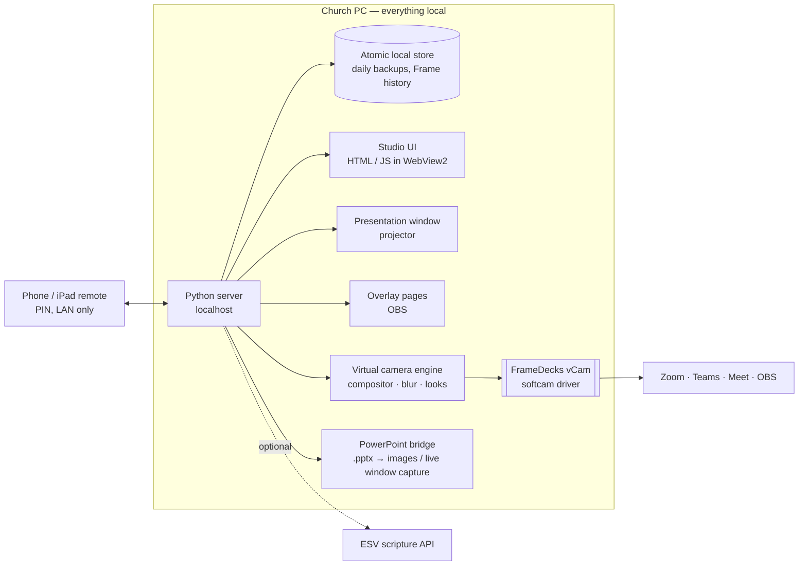

# Case study · FrameDecks — Present. Equip. Inspire.

> A service presentation platform for churches and ministries, built for the people who actually run Sunday:
> volunteers. One PC drives the room, the video call and the stream at the same time — and the screen is always one
> key away from safe.

| | |
|---|---|
| **Role** | Product owner, architect and sole engineer |
| **Status** | v26.11 (Nov 2026; versions are YY.MM) · in use for teaching, Bible study, small-group and hybrid services, with documented gaps |
| **Stack** | Python 3.12 (local server, desktop shell, virtual camera) · vanilla JavaScript / HTML / CSS · MediaPipe segmentation · softcam · WebView2 · Inno Setup · GitHub Actions · optional web companion: Next.js + Supabase on Cloudflare Pages |
| **Source** | Open source, Apache License 2.0 — [github.com/mshobin/FrameDecks](https://github.com/mshobin/FrameDecks) · download at [framedecks.com](https://framedecks.com) |
| **History** | Started as *BSF Command Center* (a Bible-study presentation tool), renamed BCC, then Kingdom Connect at v6.1, and **FrameDecks** in October 2026 |

---

## 1 · Business challenge

Hybrid church meetings run on volunteers with a laptop, a webcam, a projector and a Zoom call. Commercial worship
software is subscription-priced, cloud-tied and built for production teams. In practice, volunteers juggle
PowerPoint, screen sharing and chat — and a wrong click shows the wrong thing to everyone.

**The goal:** one free, offline tool that a new volunteer can run after a short walkthrough, which presents to the
room, the call and the stream at once, and **never puts a live service at risk.**

## 2 · Solution design

- **Frames and Content** — one Frame per moment of the service (Welcome, Worship, Scripture, Discussion, Prayer,
  Closing), each owning its questions, scriptures, text, timers, media and PowerPoint, so duplicating last week's
  service never changes it.
- **Three outputs at once** — the **FrameDecks vCam** virtual camera (webcam + Frame overlay, background blur) for
  Zoom / Teams / Meet / OBS; a full-screen Presentation window for projectors; transparent overlay pages for OBS.
- **Safety controls** — Go Live, Hide all (Esc), Blackout (K), Emergency screen, Freeze and Annotate.
- **Phone remote** — one view with big Previous / Next, Teleprompter, Draw, Freeze and Black screen;
  PIN-protected, local network only; draw on the live picture.
- **Speaker View** — answer, notes, what's next and timers that only the leader sees.
- **Planning** — templates, favourites and an **Excel Meeting Workbook** (guided Meeting Form + Dashboard) with import
  preview, undo and export.
- **Web companion (optional)** — teams plan together and sync service metadata; media, rendering and camera output
  stay on the PC.

## 3 · Architecture

### Key decisions

| Decision | Why |
|---|---|
| **Local server + browser UI**, no framework, no npm build | Volunteers' PCs vary; zero build step means fewer things break between Sundays |
| Own **virtual camera** instead of screen-sharing | The Frame is on the call even when nobody remembers to share; background blur comes for free |
| **Frame-owned content** | Copying a service is safe by construction; tests prove duplicates are independent |
| **Same installer identity across renames**, data moved on first start | Every update installs over the previous one (whatever it was called) and keeps each church's data |
| Pinned build constraints | The same code always produces the same installer |

## 4 · Implementation approach

Iterative releases driven by real services: **100+ versions from v4.0 to v26.11**, each with release notes. CI builds
the virtual-camera DLLs (64- and 32-bit) with recorded SHA-256 hashes, runs a start-up self-check, the automated
store and workbook tests and a documentation link check, then builds the Inno Setup installer with a checksum and
publishes it on version tags.

Documentation is written **per church role**: worship leaders, media team, service operators, remote operators,
volunteers, and a service-day checklist — plus developer guides for branching, releases, testing and code style.

## 5 · Outcomes

- A complete hybrid meeting run from one Windows PC, with phone or iPad control.
- **No telemetry, and no account needed to present**; online features (workspace sync, scripture lookup, a daily
  update check) are optional, and a service keeps running offline.
- A CI-built, checksummed installer that preserves each church's data across upgrades.
- Role-based guides that let volunteers learn their part without reading the whole manual.

## 6 · Lessons learned

1. **Design for the least technical operator.** The phone remote leads with big Previous / Next and Black screen
   buttons because that is what most volunteers need.
2. **Safety beats features.** Every new feature is checked against "can this interrupt a live service?"
3. **Removing a feature is a feature.** Team Space (peer-to-peer collaboration over WireGuard) shipped in 6.4 and was
   removed in the next release when it added risk without enough value.
4. **Real hardware finds what simulation can't** — the next phase is field testing on real church PCs and webcams.

## 7 · Roadmap

Code signing (SignPath Foundation, applied Nov 2026) · Playwright UI tests in CI for Go Live, stepping, Hide all,
remote and annotation · a song / lyrics library. *Done:* licence chosen and repository published under Apache 2.0.

## 8 · Screenshots

Real captures of the Studio, the Presentation window, the phone remote and a short Go Live → Next → Black screen GIF
are in the [FrameDecks README](https://github.com/mshobin/FrameDecks#screenshots) (`docs/images/`). Still to add: a
photo of a real room setup with no faces visible.
