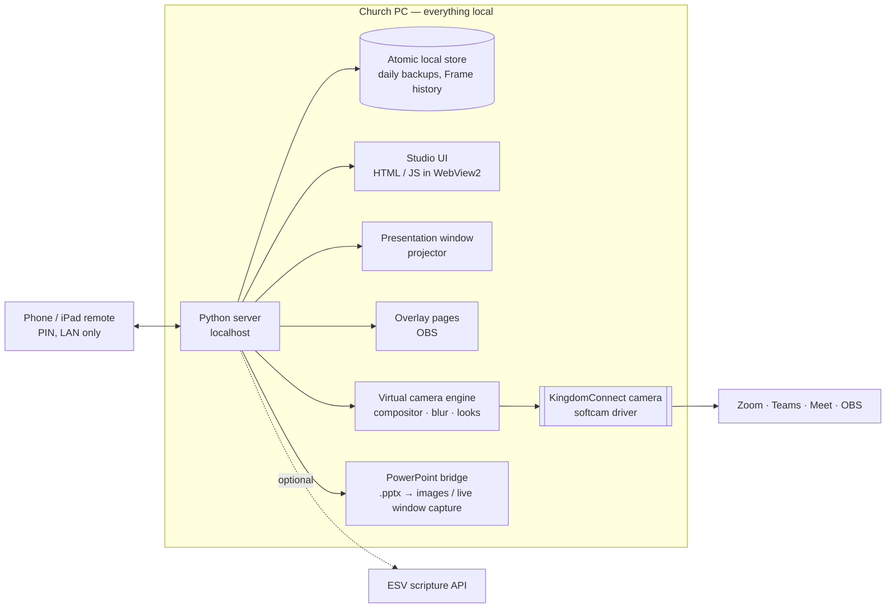

# Case study · Kingdom Connect — Connect. Present. Worship.

> A service presentation platform for churches and ministries, built for the people who actually run Sunday:
> volunteers. One PC drives the room, the video call and the stream at the same time — and the screen is always one
> key away from safe.

| | |
|---|---|
| **Role** | Product owner, architect and sole engineer |
| **Status** | v6.6 (Oct 2026) · in use for teaching, Bible study, small-group and hybrid services, with documented gaps |
| **Stack** | Python 3.12 (local server, desktop shell, virtual camera) · vanilla JavaScript / HTML / CSS · MediaPipe segmentation · softcam · WebView2 · Inno Setup · GitHub Actions |
| **Source** | Private. Available for walkthrough on request. |
| **History** | Started as *BSF Command Center* (a Bible-study presentation tool), renamed BCC, then Kingdom Connect at v6.1 |

---

## 1 · Business challenge

Hybrid church meetings run on volunteers with a laptop, a webcam, a projector and a Zoom call. Commercial worship
software is subscription-priced, cloud-tied and built for production teams. In practice, volunteers juggle
PowerPoint, screen sharing and chat — and a wrong click shows the wrong thing to everyone.

**The goal:** one free, offline tool that a new volunteer can run after a short walkthrough, which presents to the
room, the call and the stream at once, and **never puts a live service at risk.**

## 2 · Solution design

- **Frames and Content** — one Frame per moment of the service (Welcome, Worship, Scripture, Discussion, Prayer,
  Closing), each owning its questions, scriptures, text, timers, media and PowerPoint, so duplicating last week's
  service never changes it.
- **Three outputs at once** — the **KingdomConnect virtual camera** (webcam + Frame overlay, background blur) for
  Zoom / Teams / Meet / OBS; a full-screen Presentation window for projectors; transparent overlay pages for OBS.
- **Safety controls** — Go Live, Hide all (Esc), Blackout (K), Emergency screen, Freeze and Annotate.
- **Phone remote** — Simple and Advanced profiles, PIN-protected, local network only; draw on the live picture.
- **Speaker View** — answer, notes, what's next and timers that only the leader sees.
- **Planning** — templates, favourites and a five-sheet **Excel Meeting Workbook** with import preview, undo and
  export.

## 3 · Architecture

### Key decisions

| Decision | Why |
|---|---|
| **Local server + browser UI**, no framework, no npm build | Volunteers' PCs vary; zero build step means fewer things break between Sundays |
| Own **virtual camera** instead of screen-sharing | The Frame is on the call even when nobody remembers to share; background blur comes for free |
| **Frame-owned content** | Copying a service is safe by construction; tests prove duplicates are independent |
| **Keep the legacy install and data folder names** after renaming | Every update installs over the previous one and keeps each church's data |
| Pinned build constraints | The same code always produces the same installer |

## 4 · Implementation approach

Iterative releases driven by real services: **20+ versions from v4.0 to v6.6**, each with release notes. CI builds
the virtual-camera DLLs (64- and 32-bit) with recorded SHA-256 hashes, runs a start-up self-check, the automated
store and workbook tests and a documentation link check, then builds the Inno Setup installer with a checksum and
publishes it on version tags.

Documentation is written **per church role**: worship leaders, media team, service operators, remote operators,
volunteers, and a service-day checklist — plus developer guides for branching, releases, testing and code style.

## 5 · Outcomes

- A complete hybrid meeting run from one Windows PC, with phone or iPad control.
- **No accounts, subscriptions, cloud or telemetry**; the only online call is an optional scripture lookup with an
  offline fallback.
- A CI-built, checksummed installer that preserves each church's data across upgrades.
- Role-based guides that let volunteers learn their part without reading the whole manual.

## 6 · Lessons learned

1. **Design for the least technical operator.** The Simple remote exists because most volunteers only need Next,
   Back and Black Screen — in big buttons.
2. **Safety beats features.** Every new feature is checked against "can this interrupt a live service?"
3. **Removing a feature is a feature.** Team Space (peer-to-peer collaboration over WireGuard) shipped in 6.4 and was
   removed in the next release when it added risk without enough value.
4. **Real hardware finds what simulation can't** — the next phase is field testing on real church PCs and webcams.

## 7 · Roadmap

Code signing · Playwright UI tests in CI for Go Live, stepping, Hide all, remote and annotation · a song / lyrics
library · choosing and publishing a licence.

## 8 · Screenshots strategy

The repo already has `docs/images/` (Studio, Speaker View, canvas edit, annotate, Simple and annotate remotes). Reuse
them; add a 10-second GIF of Go Live → Next → Blackout, and a photo of a real room setup with no faces visible.
