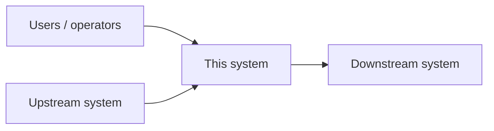
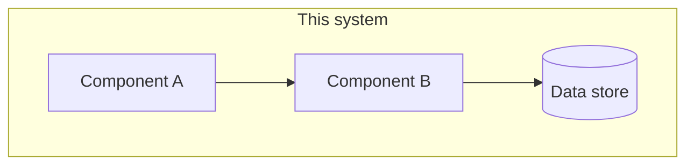
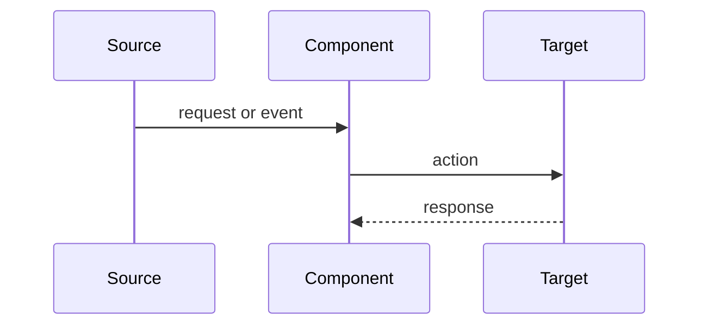

# {{System name}} — Architecture

| | |
|---|---|
| **Owner** | {{name}} |
| **Status** | {{Draft | Reviewed | Current}} · last reviewed {{YYYY-MM-DD}} |
| **Scope** | {{what this document covers, and what it does not}} |

## 1. Context
{{The business problem, who uses the system and what "working" means. Include the key quality goals in priority
order, e.g. 1. no lost events · 2. < 60 s event-to-incident · 3. operable by L1 staff.}}

## 2. System context (C4 level 1)



## 3. Containers & components (C4 level 2)



| Component | Responsibility | Technology | Owner |
|---|---|---|---|
| {{name}} | {{one sentence}} | {{tech}} | {{team}} |

## 4. Key flows



## 5. Data
{{Entities, where they live, retention, classification (public / internal / confidential), and who may read them.}}

## 6. Integration contracts
| Interface | Direction | Protocol / auth | Volume | Failure behavior |
|---|---|---|---|---|
| {{API / queue}} | in / out | {{REST + API key}} | {{events/min}} | {{retry, DLQ, alert}} |

## 7. Quality attributes
| Attribute | Target | How it's met | How it's verified |
|---|---|---|---|
| Availability | {{99.9 %}} | {{HA pair}} | {{failover test}} |
| Latency | {{< 60 s}} | {{…}} | {{synthetic event}} |
| Security | {{…}} | {{least privilege, secrets in vault}} | {{review}} |

## 8. Security
Trust boundaries · authentication and authorization · secrets handling · threats considered (STRIDE table or link
to THREAT_MODEL.md) · residual risks.

## 9. Operations
Deployment · monitoring of the system itself · runbooks · backup & restore · capacity.

## 10. Decisions
| ADR | Decision | Status |
|---|---|---|
| [ADR-001](adr/ADR-001-{{slug}}.md) | {{decision}} | Accepted |

## 11. Risks & open questions
- {{risk}} — {{mitigation / owner}}

---

## ADR template (`docs/adr/ADR-NNN-slug.md`)

```markdown
# ADR-NNN: {{Decision title}}
- Status: Proposed | Accepted | Superseded by ADR-MMM
- Date: YYYY-MM-DD

## Context
{{The forces at play: requirements, constraints, what hurts today.}}

## Options considered
1. {{Option}} — pros / cons
2. {{Option}} — pros / cons

## Decision
{{What we chose, in one or two sentences.}}

## Consequences
{{What becomes easier, what becomes harder, what we must now watch.}}
```
