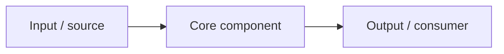

<!--
  Repository README template — mshobin portfolio standard
  Copy to README.md, replace every {{placeholder}}, delete sections that don't apply.
  House rules: lead with the problem and the outcome; every claim verifiable; say plainly what isn't done.
-->

<p align="center"></p>

# {{Project name}}

**{{Three-to-five-word tagline}}**

{{One paragraph: who it is for, the problem it solves, and the single most important property
(e.g. "runs entirely offline", "cuts event noise by correlating on topology").}}

<p>
  
  
  
</p>

> **Status:** {{Alpha | Beta | Stable}} — {{one sentence on readiness and the biggest known gap}}.
> See [Known limitations](#known-limitations).

---

## Why this exists
{{2–4 sentences. The business or operational problem, in the reader's words. Who feels the pain and what it costs.}}

## What it does
- **{{Capability}}** — {{outcome for the user, not the implementation}}
- **{{Capability}}** — {{…}}
- **{{Capability}}** — {{…}}

## Architecture overview



{{Two or three sentences on the main design decision and its trade-off. Link to docs/architecture.md and docs/adr/.}}

## Getting started

### Prerequisites
- {{Runtime and version}}
- {{Access needed, e.g. "a BMC Helix tenant and an API access key with event write permission"}}

### Install
```bash
{{install command}}
```

### Quick start
```bash
{{the smallest command that shows the value}}
```
{{Expected output, or a screenshot.}}

## Configuration

| Setting | Env var | Default | Description |
|---|---|---|---|
| {{setting}} | `{{ENV_VAR}}` | `{{default}}` | {{what it changes}} |

Secrets are read from environment variables or a secret store — **never** from files committed to this repo.

## Screenshots
| {{View 1}} | {{View 2}} |
|---|---|
|  |  |

## Known limitations
- {{What doesn't work yet, and the workaround}}
- {{What has not been tested, e.g. specific versions}}

## Roadmap
See [ROADMAP.md](ROADMAP.md). Next up: {{one or two items}}.

## FAQ
<details><summary><b>{{Question}}</b></summary>

{{Answer}}
</details>

## Documentation
| Topic | Documents |
|---|---|
| Using it | [Getting started](docs/getting-started.md) · [Configuration](docs/configuration.md) · [Troubleshooting](docs/troubleshooting.md) |
| Architecture | [Architecture](docs/architecture.md) · [ADRs](docs/adr/) |
| Project | [Roadmap](ROADMAP.md) · [Changelog](CHANGELOG.md) · [Contributing](CONTRIBUTING.md) · [Security](SECURITY.md) |

## Contributing
Issues and pull requests are welcome — see [CONTRIBUTING.md](CONTRIBUTING.md).

## License
{{MIT | Apache-2.0}} — see [LICENSE](LICENSE). {{Product names are trademarks of their owners; this project is not
affiliated with or endorsed by them.}}

<p align="center"><sub>Built by <a href="https://github.com/mshobin">Shobin Mathews</a> · Enterprise IT Operations Architect</sub></p>
